# TRADE OPS

<div align="center">
  
</div>

**A multi-tenant warehouse and customs platform for Container Freight Stations, Free Industrial Zones, and Free Commercial Zones.**

Built on Next.js 16, tRPC v11, Prisma, and PostgreSQL, with an optional AI
layer for document extraction, HS classification assistance, demand
forecasting, and agent-assisted trade operations.

[](./LICENSE)
[](https://nodejs.org)
[](./tsconfig.json)

---

## What this is

TradeOps CFS WMS manages the operational and regulatory lifecycle of cargo moving
through a Container Freight Station or a Free Zone: gate-in, storage, slot
allocation, inventory, bonded ledger, declaration preparation, duty and tax
calculation, and gate-out. It is **multi-tenant** by design, so a single
deployment can serve multiple zone operators with isolated data.

## What this is not

- It is **not a customs declaration filing system**. It prepares, validates,
  and audits declarations; submission to JKDM (Royal Malaysian Customs
  Department) systems is via integration, not direct.
- It is **not a substitute for a customs ruling**. All duty, sales tax, and
  excise figures produced by this system are indicative and must be verified
  against the current Customs Duties Order, Excise Duties Order, and Sales Tax
  Orders. See [Security → Regulatory accuracy](./SECURITY.md#2-regulatory-data-integrity-high-severity).
- It is **not a general-purpose WMS**. It is opinionated toward customs-bonded
  and free-zone operations. If you need a pick-and-pack WMS for domestic
  e-commerce, this is the wrong tool.

---

## Table of Contents

- [Status](#status)
- [Capabilities](#capabilities)
- [Architecture](#architecture)
- [The tariff backbone](#the-tariff-backbone)
- [Core technologies](#core-technologies)
- [Authentication and authorisation](#authentication-and-authorisation)
- [Multi-tenancy](#multi-tenancy)
- [The intelligence layer](#the-intelligence-layer)
- [Background jobs](#background-jobs)
- [Data stores](#data-stores)
- [Quick start](#quick-start)
- [Project structure](#project-structure)
- [Configuration](#configuration)
- [Testing](#testing)
- [Observability](#observability)
- [Security](#security)
- [Performance](#performance)
- [Deployment](#deployment)
- [Roadmap](#roadmap)
- [Contributing](#contributing)
- [License](#license)
- [Sources and acknowledgements](#sources-and-acknowledgements)

---

## Status

| Aspect | State |
| ------ | ----- |
| Core WMS operations | Stable |
| Multi-tenant isolation | Stable |
| RBAC / ABAC | Stable |
| HS classification + duty engine | Stable, backed by [`hs-code-data`](./src/hs-code-data.ts) |
| RAG over cargo documents | Beta |
| Agent mesh orchestration | Beta |
| Digital twin | Experimental |
| Federated learning | Experimental |
| Quantum-hybrid optimisation | Research spike, not production |

"Experimental" and "Research spike" mean exactly that: do not enable them in a
production tenant. They are gated behind feature flags and are off by default.

---

## Capabilities

### Operations

- Gate-in / gate-out with weighbridge, ANPR, and scanner integration.
- Slot allocation and yard planning.
- Inventory with lot, batch, and serial tracking.
- Cargo lifecycle: consignment, house bill, master bill, container, package.
- Bonded ledger for duty-suspended goods.
- FIZ manufacturing and FCZ trading semantics.
- Exemption and drawback claim tracking.
- Document management with version history.

The operational lifecycle of a consignment is a deterministic finite-state
machine. Every transition is audited and, where the cargo is customs-relevant,
gated on a validated declaration.

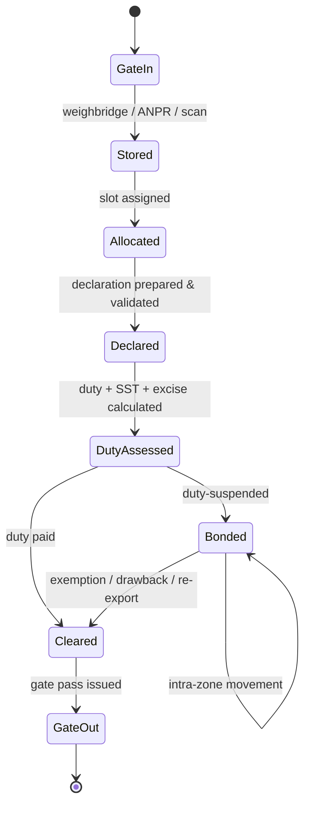

### Compliance

- HS code classification with an auditable decision trail.
- MFN, ATIGA, ACFTA, RCEP, CPTPP, MJEPA, and MCFTA rate resolution.
- Duty, sales tax, and excise calculation, including specific (non-ad-valorem)
  duties.
- Controlled-goods and import-quota flagging against agency control lists
  (MAQIS, SIRIM, MITI, MDA, Drug Control Authority).
- Audit log of every human and agent action, with evidence.
- Declaration preparation and validation. Submission is a separate integration.

### Intelligence (optional)

- Natural-language search over cargo documents and declarations (RAG).
- HS classification suggestions with confidence and citation.
- Demand and capacity forecasting.
- Anomaly and compliance-risk detection.
- Multi-agent workflows for document intake, ops reporting, and declaration
  audit. All high-stakes actions require human approval.

### Platform

- Pool, silo, and cellular tenancy models.
- Per-tenant encryption keys.
- SSO / SCIM for enterprise tenants.
- Webhooks and event stream for downstream systems.

---

## Architecture

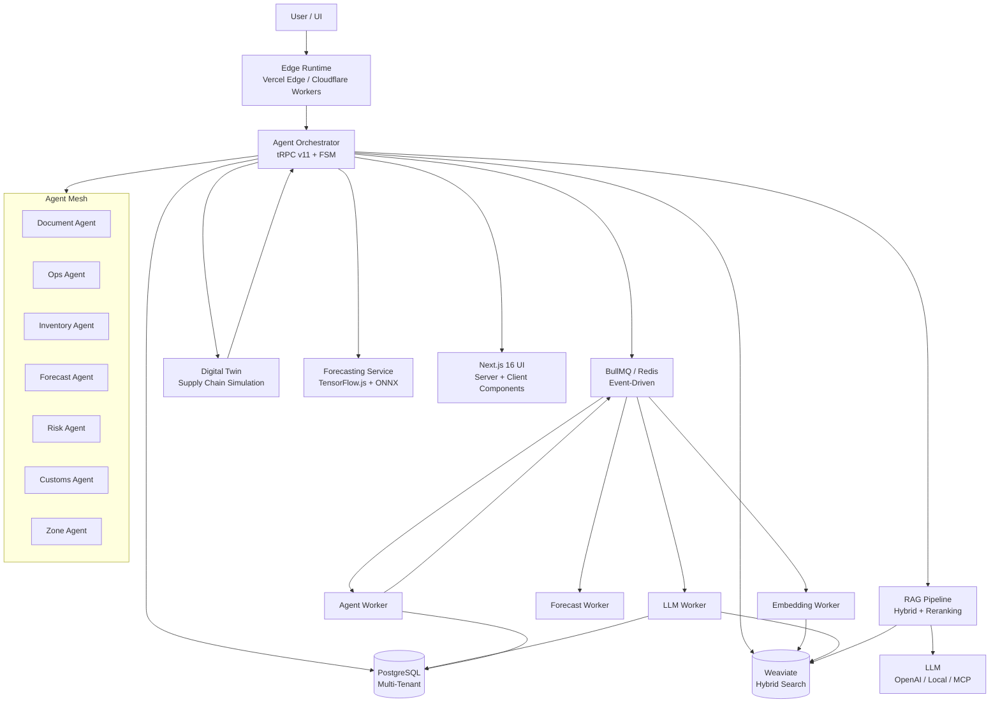

The orchestrator is the single entry point for all server-side work. It is
responsible for:

1. Resolving the tenant and injecting isolation into the request context.
2. Enforcing RBAC and ABAC before any handler runs.
3. Routing to a deterministic finite-state machine for long-running tasks.
4. Sequencing AI pipelines (embed → search → rerank → generate).
5. Dispatching background work to BullMQ with idempotency keys.
6. Writing an audit record for every state transition.

The request lifecycle for a mutating procedure is shown below. Note that
authorisation is evaluated **before** the handler runs, and that the tenant
filter is applied to the Prisma client itself, not left to the handler.

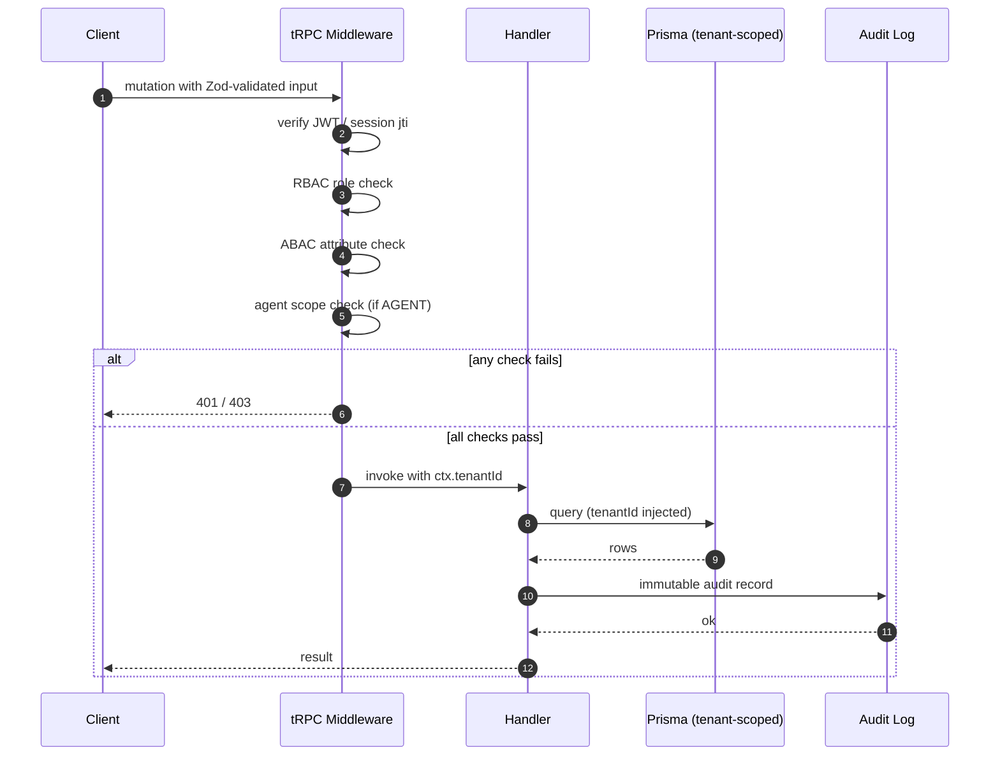

---

## The tariff backbone

Every customs-relevant calculation in this system resolves through a single
tariff dataset: [`hs-code-data.ts`](./src/hs-code-data.ts). That module is the
authoritative source for:

- HS/AHTN 2022 subheadings (6-digit level).
- Malaysian MFN import duty rates.
- Sales tax (SST) rates.
- Excise rates, both ad valorem and specific.
- Preferential rates under ATIGA, ACFTA, RCEP, CPTPP, MJEPA, and MCFTA.
- Controlled-goods, import-quota, and hazardous flags, with agency references.
- Carbon tax applicability.

### How the engine uses it

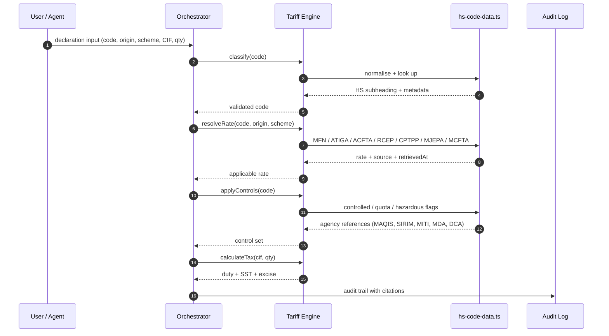

### Data provenance

The tariff dataset cites primary sources in its header. The same discipline
applies to every rate in the database:

- **Federal Gazette** — `P.U.(A)` instruments (e.g. `P.U.(A) 114/2022`).
- **JKDM HS Explorer** — the Royal Malaysian Customs Department's official
  lookup, with retrieval date recorded.
- **Agency control lists** — MAQIS, SIRIM, MITI, MDA, Drug Control Authority.
- **MITI FTA schedules** — noting the HS version each schedule uses.

Every rate row carries a `source` and `retrievedAt` field. A rate with no
source is a bug, not a feature. See [CONTRIBUTING.md](./CONTRIBUTING.md#the-golden-rule-source-everything).

---

## Core technologies

| Layer | Technology |
| ----- | ---------- |
| Frontend | Next.js 16 (App Router, Cache Components), React 19, Tailwind CSS |
| API | NestJS + tRPC v11, Next.js Route Handlers, backend-hosted MCP at `/api/mcp` |
| Database | PostgreSQL 16, Prisma ORM |
| Cache / queue | Redis 7, BullMQ |
| Vector store | Weaviate (BM25 + vector hybrid) |
| AI / ML | LangChain, OpenAI-compatible LLMs, TensorFlow.js, ONNX Runtime, backend-hosted MCP |
| Agent framework | Agent Mesh, contractual task orchestration, FSM routing |
| Edge | Vercel Edge, Cloudflare Workers, on-prem ONNX inference |
| Auth | JWT, bcrypt/argon2, WebAuthn passkeys, SSO/SCIM |
| Runtime | Node 20 LTS or newer |
| Deployment | Docker, Kubernetes, Vercel |

Runtime dependencies are kept deliberately small. The tariff module has **no
runtime dependencies** so it can be vendored into air-gapped customs systems.

---

## Authentication and authorisation

### Authentication

- Password login with argon2id hashing.
- WebAuthn passkeys as a second factor, and as a primary credential where the
  tenant enables it.
- Short-lived access tokens (15 minutes) with rotating refresh tokens.
- Session revocation via a Redis denylist keyed on token `jti`.
- SSO via SAML 2.0 or OIDC for enterprise tenants, with SCIM 2.0 provisioning.

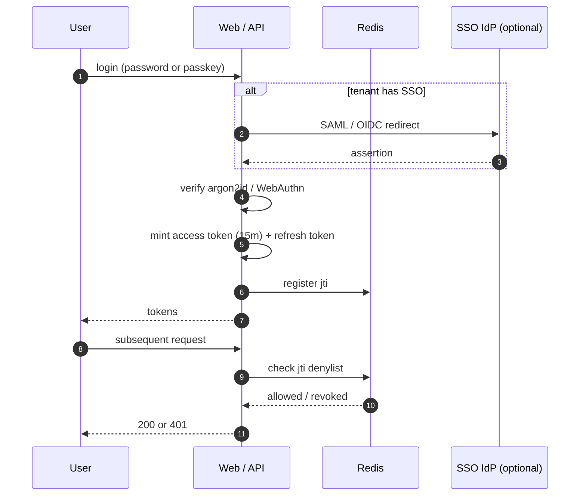

### Roles

| Role | Scope |
| ---- | ----- |
| `SUPER_ADMIN` | Cross-tenant administration. Not available to tenants. |
| `ADMIN` | Full control of one tenant, including agent configuration. |
| `OPS_MANAGER` | Warehouse operations, workflow approval, agent oversight. |
| `WAREHOUSE_STUFF` | View cargo, update status, gate operations. |
| `CUSTOMER` | View own shipments, submit declarations. |
| `AGENT` | Scoped service account for automated actions. |

### Authorisation model

Access is the intersection of three checks:

1. **Role** — what the principal is allowed to do in general.
2. **Attribute** — tenant, zone, commodity sensitivity, cargo value, and
   control-list membership.
3. **Scope** — for agents, the explicit scopes granted to that agent instance.

All three are evaluated in tRPC middleware before the handler runs. A handler
that bypasses middleware is a bug; there is a lint rule that forbids calling
`prisma` directly from a router.

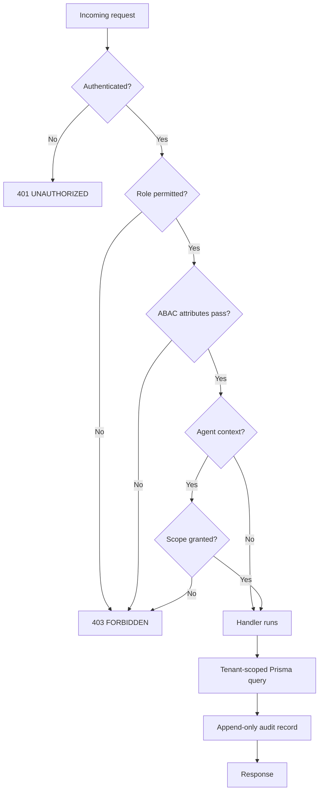

```ts
export const protectedProcedure = t.procedure.use(({ ctx, next }) => {
  if (!ctx.user) throw new TRPCError({ code: 'UNAUTHORIZED' });
  return next({ ctx: { ...ctx, user: ctx.user, tenantId: ctx.tenantId! } });
});

export const roleProcedure = (...roles: Role[]) =>
  protectedProcedure.use(({ ctx, next }) => {
    if (!roles.includes(ctx.user.role)) throw new TRPCError({ code: 'FORBIDDEN' });
    return next();
  });

export const agentProcedure = roleProcedure('AGENT').use(({ ctx, next }) => {
  if (!ctx.agent) throw new TRPCError({ code: 'FORBIDDEN', message: 'No agent context' });
  if (!ctx.agent.scopes.includes(ctx.route)) {
    throw new TRPCError({ code: 'FORBIDDEN', message: 'Scope not granted' });
  }
  return next();
});
```

---

## Multi-tenancy

Three isolation models are supported. The model is chosen per tenant at
provisioning time and cannot be changed without a migration.

| Model | Isolation | Intended for |
| ----- | --------- | ------------ |
| **Pool** | Shared database, `tenantId` column scoping | SMB, fast onboarding |
| **Silo** | Dedicated database per tenant | Enterprise, regulated entities |
| **Cellular** | Isolated data plane per cell, shared control plane | Blast-radius containment, regional data residency |

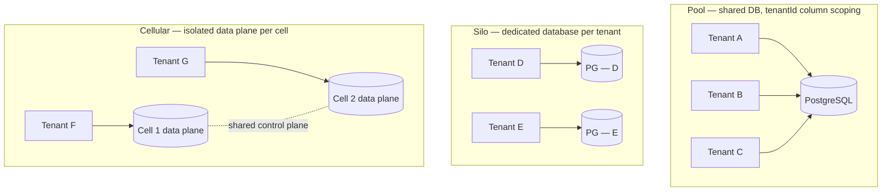

For cellular tenants, the Prisma client itself is bound at context creation to
the cell's connection string, so a query cannot physically reach another cell's
data even if the `tenantId` filter were omitted.

### Tenant-scoped queries

Every tenant-scoped model carries `tenantId`, and every query is filtered:

```ts
ctx.db.cargo.findMany({ where: { tenantId: ctx.tenantId } });
```

This is enforced by a Prisma client extension that throws if a query on a
tenant-scoped model omits the `tenantId` filter. The extension is registered in
`lib/db.ts` and applies to all clients, including those created in workers.

---

## The intelligence layer

The AI features are optional. Each is independently gated by a feature flag and
can be disabled per tenant.

### Retrieval-augmented generation

Every answer includes the source documents it was derived from. If the
retrieval step returns nothing above the relevance threshold, the system
returns "no answer" rather than generating unsupported text.

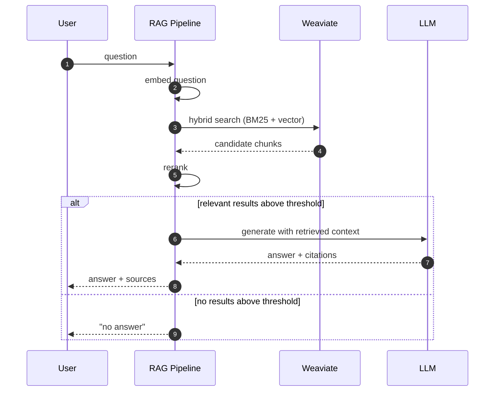

### Forecasting

Models are trained per tenant on that tenant's historical cargo volume,
seasonal patterns, and duty-suspension utilisation. Models are not shared
across tenants except through the optional federated learning path described
below. Forecasts are advisory; they do not trigger automated purchasing or
staffing actions.

### Agents

Agents are structured capabilities, not free-form chatbots. Each agent is
defined by:

- A **kind** (document, ops, inventory, forecast, risk, customs, zone).
- An explicit **scope list** naming the tRPC procedures it may call.
- A **guardrail** configuration specifying which actions require human
  approval.

An agent cannot call a procedure that is not in its scope, regardless of what
the LLM asks for. The scope check happens in `agentProcedure` middleware, not
in the prompt.

| Agent | Representative skills |
| ----- | --------------------- |
| Document | Extract fields from bills of lading, validate completeness, summarise |
| Operations | Track cargo status, flag delays, generate daily ops report |
| Inventory | Recommend slot allocation, detect overcapacity, suggest rebalancing |
| Forecast | Predict cargo volume, recommend staffing, project capacity |
| Risk | Detect anomalies, flag compliance issues, identify bottlenecks |
| Customs | Suggest HS codes, prepare declarations, audit broker entries, prepare drawback claims |
| Zone | Manage FIZ/FCZ movements, gate passes, bonded ledger, exemption claims |

High-stakes actions — anything that files, amends, or cancels a declaration;
anything that moves bonded goods; anything above a configurable value threshold
— require human approval and cannot be delegated to an agent.

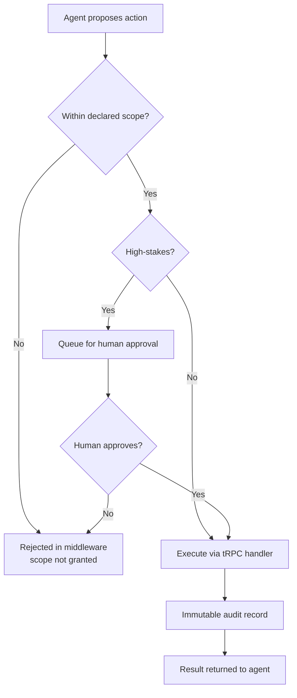

### Digital twin

The digital twin maintains a live model of the zone: yard occupancy, gate
throughput, dwell times, equipment state. It is used for what-if analysis:
"What happens to gate congestion if we shift the Wednesday inbound peak to
Tuesday?" It is not used to make automated operational decisions.

### Federated learning

Cross-tenant model training without sharing raw data. Each tenant trains
locally and shares only gradient updates, which are aggregated server-side
with differential privacy noise. This feature is experimental and off by
default. It requires explicit opt-in from every participating tenant.

### Quantum-hybrid optimisation

A research spike exploring quantum annealing for multi-commodity network flow
and vehicle routing. Not in the production path. Any results it produces are
compared against classical solvers before being surfaced to users.

---

## Background jobs

BullMQ workers run on Redis. Each worker is idempotent and carries a
`tenantId` on every job payload.

| Worker | Responsibility |
| ------ | -------------- |
| `embeddingWorker` | Chunk and embed new documents; upsert to Weaviate |
| `llmWorker` | Long-running generation, batch report creation |
| `forecastWorker` | Scheduled model training and prediction |
| `agentWorker` | Multi-step agent workflows with retry and escalation |
| `twinWorker` | Advance twin simulation ticks and scenario runs |

Failed jobs land in a dead-letter queue with the full error context and are
surfaced in the admin UI. Jobs are retried with exponential backoff, capped at
five attempts.

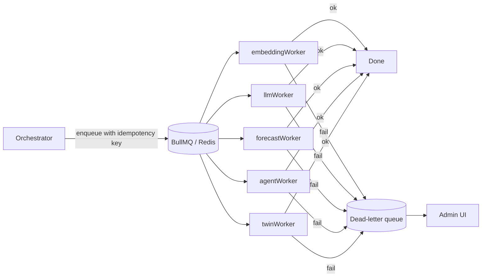

---

## Data stores

| Store | Purpose | Backup |
| ----- | ------- | ------ |
| PostgreSQL | Tenants, users, cargo, inventory, agents, audit log | Continuous WAL archiving, PITR |
| Redis | Queue, cache, rate limiting, agent heartbeats | AOF, daily snapshot |
| Weaviate | Vector embeddings for semantic search | Daily snapshot |

The audit log is append-only. No application code path issues an `UPDATE` or
`DELETE` against it; this is enforced by a database role permission, not by
convention.

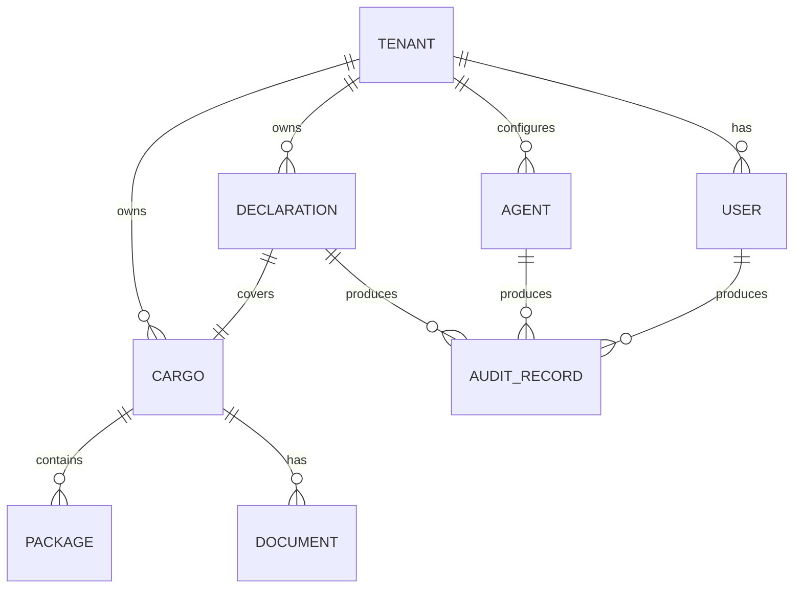

---

## Quick start

### Prerequisites

- Node 20 LTS or newer
- pnpm 9 or newer
- Docker and Docker Compose (for local Postgres, Redis, Weaviate)

### Setup

```bash
git clone https://github.com/<your-org>/cfs-wms.git
cd cfs-wms
pnpm install

cp .env.example .env
# Edit .env — at minimum set DATABASE_URL, REDIS_URL, WEAVIATE_URL, JWT_SECRET

docker compose up -d
pnpm prisma migrate dev
pnpm prisma db seed        # creates a demo tenant and admin user
pnpm dev                   # http://localhost:3000
```

### Workers

In separate terminals, or via the provided `pnpm workers` script:

```bash
pnpm workers   # runs all workers concurrently via concurrently
```

### Agent mesh

The agent mesh is optional and off by default. To run it locally:

```bash
pnpm agents:dev
```

### Demo credentials

The seed script prints the demo tenant slug and admin credentials to stdout.
Do not use the demo credentials in any environment that is reachable from the
internet.

---

## Project structure

```
cfs-wms/
├── app/                        # Next.js 16 App Router
│   ├── (marketing)/            # Public routes: landing, login, register, MFA
│   ├── (app)/                  # Authenticated shell
│   │   ├── dashboard/
│   │   ├── trade-ops/
│   │   ├── fiz/
│   │   ├── fcz/
│   │   ├── wms/
│   │   ├── order-management/
│   │   ├── cargo/
│   │   ├── digital-twin/
│   │   ├── integration/
│   │   ├── custom-agents/
│   │   └── admin/
│   └── api/
│       ├── trpc/[trpc]/route.ts
│       ├── webhooks/
│       ├── upload/
│       ├── cron/
│       └── agents/
├── server/
│   ├── trpc/
│   │   ├── context.ts
│   │   ├── middleware.ts
│   │   ├── router.ts
│   │   └── routers/            # auth, cargo, inventory, ai, agents, orchestrator
│   ├── auth/                   # JWT, RBAC, passkeys, SSO
│   └── agents/
│       ├── base.ts
│       ├── mesh.ts             # Orchestrator
│       ├── documentAgent.ts
│       ├── opsAgent.ts
│       ├── inventoryAgent.ts
│       ├── forecastAgent.ts
│       ├── riskAgent.ts
│       ├── customsAgent.ts
│       ├── zoneAgent.ts
│       └── skills/
├── src/
│   └── hs-code-data.ts         # Tariff backbone
├── lib/
│   ├── db.ts                   # Prisma client + tenant extension
│   ├── redis.ts
│   ├── queue.ts
│   ├── weaviate.ts
│   └── ai/
│       ├── embeddings.ts
│       ├── llm.ts
│       ├── rag.ts
│       ├── forecasting.ts
│       └── edge.ts
├── workers/
│   ├── embeddingWorker.ts
│   ├── llmWorker.ts
│   ├── forecastWorker.ts
│   ├── agentWorker.ts
│   └── twinWorker.ts
├── components/
├── prisma/
│   ├── schema.prisma
│   └── seed.ts
├── test/
├── docker-compose.yml
├── .env.example
├── SECURITY.md
├── CONTRIBUTING.md
├── CODE_OF_CONDUCT.md
└── package.json
```

---

## Configuration

All configuration is via environment variables. See `.env.example` for the full
list with descriptions. The ones you must set:

| Variable | Purpose |
| -------- | ------- |
| `DATABASE_URL` | PostgreSQL connection string |
| `REDIS_URL` | Redis connection string |
| `WEAVIATE_URL` | Weaviate endpoint |
| `JWT_SECRET` | Signing key for access tokens (min 32 bytes) |
| `JWT_REFRESH_SECRET` | Signing key for refresh tokens |
| `ENCRYPTION_KEY` | AES-256 key for at-rest field encryption |
| `OPENAI_API_KEY` | Optional; only required if AI features are enabled |

Feature flags:

| Flag | Default | Effect |
| ---- | ------- | ------ |
| `FF_RAG` | `false` | Enables retrieval-augmented generation |
| `FF_AGENTS` | `false` | Enables the agent mesh |
| `FF_TWIN` | `false` | Enables the digital twin |
| `FF_FEDERATED` | `false` | Enables federated learning |
| `FF_QUANTUM` | `false` | Enables the quantum-hybrid solver spike |

All flags default to `false`. Enable them per environment, and per tenant via
the admin UI.

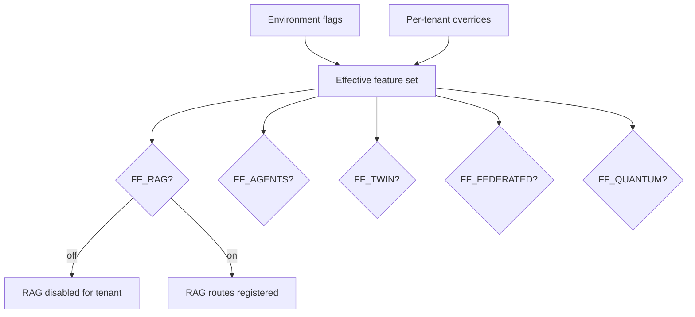

---

## Testing

```bash
pnpm test            # unit + integration (vitest)
pnpm test:e2e        # end-to-end (playwright)
pnpm test:coverage   # coverage report
pnpm typecheck       # tsc --noEmit
pnpm lint            # eslint + prettier
```

### What is tested

- **Tariff engine** — every rate lookup, control flag, and tax calculation has
  a fixture-backed test. A change to `hs-code-data.ts` that alters a rate
  without updating the corresponding fixture fails CI.
- **Tenant isolation** — a suite of adversarial tests that attempt cross-tenant
  reads and writes through every router.
- **Authorisation** — a matrix test that asserts every procedure rejects every
  role that should not have access.
- **Agent scopes** — tests that assert an agent cannot call a procedure outside
  its declared scope, regardless of the prompt.
- **Idempotency** — worker jobs are run twice and asserted to produce the same
  state.

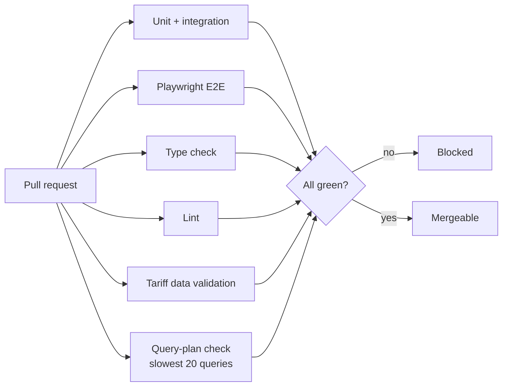

### Tariff data validation

`pnpm test:tariff` runs a dedicated suite that:

1. Asserts no duplicate 6-digit codes exist.
2. Asserts every controlled good has a `controlList` reference.
3. Asserts every specific excise duty has a unit string.
4. Asserts every rate change has a corresponding entry in `CHANGELOG-tariff.md`.

---

## Observability

- **Structured logging** via pino, JSON in production, with `tenantId`,
  `userId`, `agentId`, and `traceId` on every line.
- **Distributed tracing** via OpenTelemetry, exported to your collector of
  choice (OTLP).
- **Metrics** via Prometheus endpoint at `/api/metrics`. Key series:
  `cfs_declaration_duration_seconds`, `cfs_gate_throughput_total`,
  `cfs_agent_action_total{outcome}`, `cfs_tariff_lookup_total{code,source}`.
- **Error tracking** via Sentry, with tenant and route context.
- **Audit log** — separate from application logs. Every state transition on a
  cargo, declaration, or agent action writes an immutable audit record.

```mermaid
flowchart LR
    APP[App / Workers] --> LOG[pino JSON]
    APP --> TRACE[OTel traces]
    APP --> METR[/api/metrics]
    APP --> SENTRY[Sentry]
    LOG --> SINK[Log sink]
    TRACE --> OTLP[OTLP collector]
    METR --> PROM[Prometheus]
    SENTRY --> ERR[Error dashboard]
```

### Health checks

- `GET /api/health` — liveness, returns 200 if the process is up.
- `GET /api/ready` — readiness, checks Postgres, Redis, and Weaviate.

---

## Security

See [SECURITY.md](./SECURITY.md) for the full policy and reporting process.

Summary of controls:

- TLS 1.3 in transit; AES-256 at rest with per-tenant keys.
- Argon2id password hashing.
- Rate limiting per IP, per user, and per tenant via Redis.
- Input validation with Zod on every tRPC input.
- CSRF protection on all mutating routes.
- Content Security Policy with no `unsafe-inline`.
- Dependency scanning via Dependabot and `pnpm audit` in CI.
- Secret scanning via gitleaks in pre-commit and CI.
- No secrets in logs; the logger redacts a configured set of keys.
- Agent guardrails: scopes enforced in middleware, not in prompts; high-stakes
  actions require human approval.
- Audit log is append-only, enforced by database role permissions.

### Regulatory accuracy

Incorrect tariff data is treated as a **security issue**, not merely a bug,
because under-declaration of duty exposes importers to penalties under the
Customs Act 1967. See [SECURITY.md § 2](./SECURITY.md#2-regulatory-data-integrity-high-severity)
for the reporting channel and response targets.

---

## Performance

- **React Server Components** for initial page load; client components only
  where interactivity requires them.
- **Next.js 16 Cache Components** with tag-based invalidation for navigations.
- **Turbopack** for development and production builds.
- **Streaming** for long-running queries and AI responses.
- **Redis** for hot-path caching: rate lookups, session state, feature flags.
- **Database indexes** reviewed as part of every schema change; the CI includes
  a query-plan check on the slowest 20 queries.
- **Connection pooling** via PgBouncer in transaction mode.
- **Edge runtime** for latency-sensitive routes: tariff lookup, gate status.

Benchmarks are run nightly against a synthetic dataset and published to the
`#perf` channel. We do not quote performance numbers in this document because
they depend entirely on your dataset, your hardware, and your query mix.

---

## Deployment

### Docker Compose (single node)

Suitable for staging and small production deployments. See
`docker-compose.prod.yml`.

### Kubernetes

Helm charts are in `deploy/helm/`. The chart provisions:

- Web deployment (3 replicas, HPA on CPU and request rate)
- Worker deployment (1 replica per worker type, KEDA scaling on queue depth)
- Migrations as a pre-install Job
- ServiceMonitor for Prometheus
- NetworkPolicy restricting egress to Postgres, Redis, Weaviate, and the LLM
  endpoint

### Vercel

The web tier deploys to Vercel cleanly. Workers must run elsewhere (Fly.io,
Railway, or your own Kubernetes cluster) because they are long-lived processes.

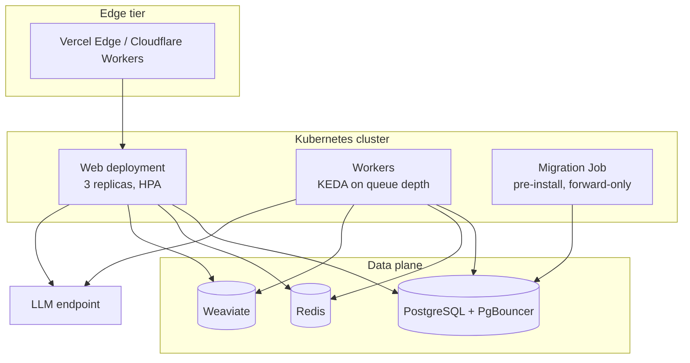

### Database migrations

Migrations run as a pre-deploy job and are **forward-only**. Every migration
must be backward-compatible with the previous release so that a rolling
deploy does not break in-flight requests. Destructive changes require a
two-release deprecation cycle.

---

## Roadmap

| Quarter | Focus |
| ------- | ----- |
| Current | Harden agent guardrails; expand tariff dataset coverage; publish integration SDK |
| Next | Multi-zone tenancy; real-time gate telemetry; declaration submission integration |
| Later | Digital twin GA; federated learning pilot with two design partners |
| Research | Quantum-hybrid solver evaluation; publish methodology and negative results |

Roadmap items are directional, not commitments. Anything not in the "Current"
row should be treated as a possibility, not a plan.

---

## Contributing

We welcome contributions. Read [CONTRIBUTING.md](./CONTRIBUTING.md) before
opening a pull request — it explains the source-citation requirement for
tariff changes, the commit conventions, and the review criteria.

For security issues, do **not** open a public issue. See [SECURITY.md](./SECURITY.md).

By participating, you agree to abide by the
[Code of Conduct](./CODE_OF_CONDUCT.md).

---

## License

MIT. See [LICENSE](./LICENSE).

The tariff dataset in `src/hs-code-data.ts` is derived from public sources:
the WCO Harmonized System 2022 nomenclature, Malaysian Federal Gazette
instruments, and Royal Malaysian Customs Department publications. Those
sources are public domain or government-published. The curated compilation,
annotations, and code are MIT-licensed.

---

## Sources and acknowledgements

- **WCO** — Harmonized System 2022 nomenclature.
- **Royal Malaysian Customs Department (JKDM)** — Customs Duties Order,
  Excise Duties Order, Sales Tax Orders, HS Explorer.
- **MITI** — FTA tariff schedules.
- **MAQIS, SIRIM, MDA, Drug Control Authority** — agency control lists.
- **Contributors** — see `git shortlog -sne`.

---

  Mermaid block itself.
